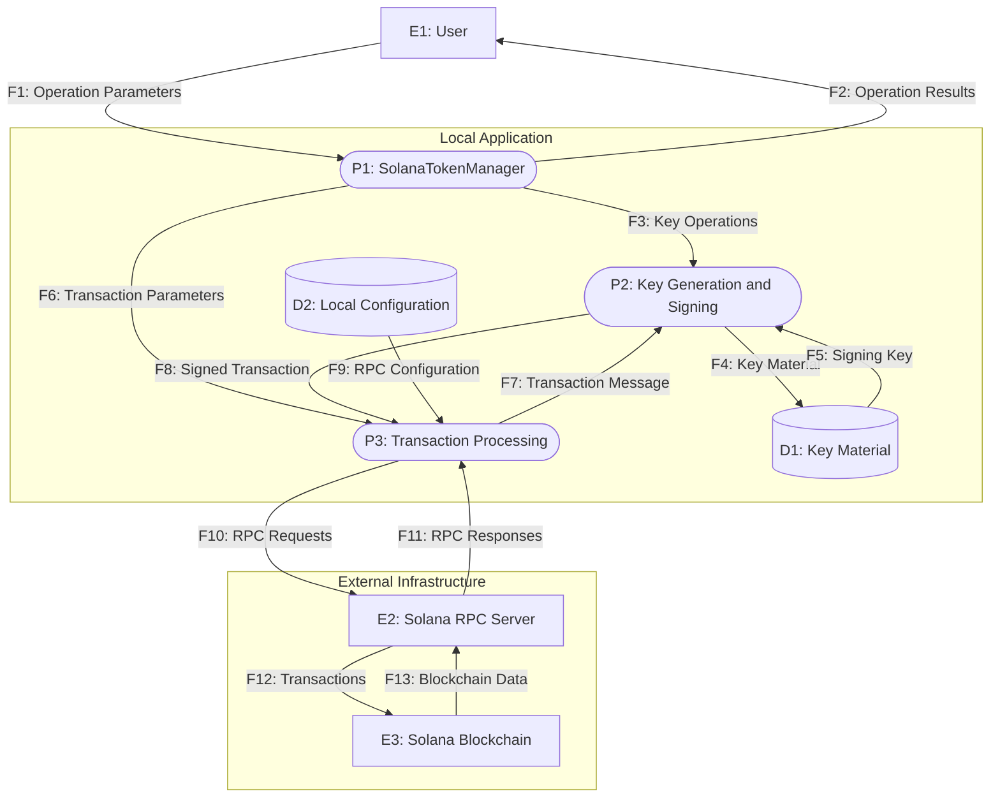

# Threat Model - SolanaTokenManager

| | |
| --- | --- |
| Назва | Модель загроз - `SolanaTokenManager` |
| Версія | 0.1.0 |
| Статус | Draft |
| Останнє оновлення | 2026-11-27 |
| Власник | Розробник проєкту |
| Пов'язані документи | `architecture.md`, `security_policy.md`, `privacy_policy.md`, `security_requirements.md` |

## Scope

Модель охоплює програмний застосунок SolanaTokenManager, генерацію криптографічних ключових пар, створення та ініціалізацію SPL-токенів, випуск токенів, підготовку операцій переказу, формування та підписання транзакцій, локальну конфігурацію та взаємодію із зовнішніми RPC-серверами Solana.

Також розглядаються загрози, пов'язані із зовнішніми програмними залежностями та локальною обробкою приватних ключів.

Поза межами моделі: внутрішня реалізація блокчейну Solana, внутрішня інфраструктура RPC-провайдерів, захист операційної системи, фізичний захист пристрою користувача, майбутня інтеграція з Pump.fun та інша нереалізована функціональність.

## System Overview

SolanaTokenManager — програмний застосунок, розроблений мовою Rust для створення та управління SPL-токенами у блокчейні Solana.

Застосунок використовує Solana SDK, SPL Token та RPC Client для генерації криптографічних ключових пар, створення токенів, формування, підписання та відправлення передбачених транзакцій.

Криптографічні операції виконуються у локальному середовищі. Взаємодія з блокчейном здійснюється через зовнішній RPC-сервер.

Основними інформаційними активами системи є:

- Приватні криптографічні ключі.
- Публічні адреси гаманців.
- Повноваження Mint Authority.
- Адреси SPL-токенів.
- Параметри транзакцій.
- Підписані транзакції.
- Конфігурація RPC-з'єднання.
- Цифрові активи користувача.
- Вихідний код та зовнішні залежності.

### Attacker Model

| ID | Тип порушника | Початковий доступ та можливості | Обмеження |
| --- | --- | --- | --- |
| AT1 | External Attacker | Доступ до публічних даних блокчейну та мережевих інтерфейсів. Може намагатися підмінити RPC-сервер або перехопити мережеві дані. | Не має початкового доступу до приватних ключів. |
| AT2 | Malicious Local User | Обмежений доступ до локального пристрою, доступних файлів, конфігурації та журналів. | Обмежений правами доступу операційної системи. |
| AT3 | Malicious RPC Provider | Контролює відповіді RPC-сервера, може повертати неправдиві дані, затримувати або блокувати запити. | Не може змінити підписану транзакцію без порушення дійсності підпису. |
| AT4 | Supply Chain Attacker | Може скомпрометувати зовнішні бібліотеки або залежності проєкту. | Потребує встановлення або виконання скомпрометованого компонента. |
| AT5 | Compromised Developer | Має доступ до скомпрометованого облікового запису розробника та може змінювати код або конфігурацію. | Обмежений правами відповідного облікового запису. |

### Data Flow Diagram

У цьому документі використовуються такі типи елементів DFD:

- **External Interactor** - зовнішній користувач або система;
- **Process** - компонент, що виконує обробку;
- **Data Store** - сховище даних;
- **Data Flow** - передавання даних між елементами;
- **Trust Boundary** - межа між областями з різним рівнем довіри.

### System Elements

| ID | DFD Type | Name |
| --- | --- | --- |
| E1 | External Interactor | User |
| E2 | External Interactor | Solana RPC Server |
| E3 | External Interactor | Solana Blockchain |
| P1 | Process | SolanaTokenManager |
| P2 | Process | Key Generation and Signing |
| P3 | Process | Transaction Processing |
| D1 | Data Store | Key Material |
| D2 | Data Store | Local Configuration |
| F1 | Data Flow | User -> SolanaTokenManager |
| F2 | Data Flow | SolanaTokenManager -> User |
| F3 | Data Flow | SolanaTokenManager -> Key Generation and Signing |
| F4 | Data Flow | Key Generation and Signing -> Key Material |
| F5 | Data Flow | Key Material -> Key Generation and Signing |
| F6 | Data Flow | SolanaTokenManager -> Transaction Processing |
| F7 | Data Flow | Transaction Processing -> Key Generation and Signing |
| F8 | Data Flow | Key Generation and Signing -> Transaction Processing |
| F9 | Data Flow | Local Configuration -> Transaction Processing |
| F10 | Data Flow | Transaction Processing -> Solana RPC Server |
| F11 | Data Flow | Solana RPC Server -> Transaction Processing |
| F12 | Data Flow | Solana RPC Server -> Solana Blockchain |
| F13 | Data Flow | Solana Blockchain -> Solana RPC Server |
| TB1 | Trust Boundary | User / Local Application |
| TB2 | Trust Boundary | Local Application / External Infrastructure |

D1 є логічним сховищем ключового матеріалу в оперативній пам'яті або захищеному локальному сховищі, якщо таке передбачене реалізацією.

D2 представляє параметри конфігурації застосунку та не обов'язково є окремим конфігураційним файлом.

### DFD Diagram

### System Relationships

- `E1 User` передає параметри операцій до `P1 SolanaTokenManager` через `F1`.
- `P1 SolanaTokenManager` повертає результати операцій користувачу через `F2`.
- Потоки `F1` та `F2` перетинають межу довіри `TB1 User / Local Application`.
- `P1 SolanaTokenManager` передає запити криптографічних операцій до `P2 Key Generation and Signing` через `F3`.
- `P2 Key Generation and Signing` передає ключовий матеріал до `D1 Key Material` через `F4`.
- `P2 Key Generation and Signing` отримує ключовий матеріал із `D1 Key Material` через `F5`.
- `P1 SolanaTokenManager` передає параметри транзакцій до `P3 Transaction Processing` через `F6`.
- `P3 Transaction Processing` передає повідомлення транзакції для підписання до `P2 Key Generation and Signing` через `F7`.
- `P2 Key Generation and Signing` повертає підписану транзакцію через `F8`.
- `P3 Transaction Processing` отримує конфігурацію RPC із `D2 Local Configuration` через `F9`.
- `P3 Transaction Processing` передає RPC-запити та підписані транзакції до `E2 Solana RPC Server` через `F10`.
- `E2 Solana RPC Server` повертає відповіді через `F11`.
- Потоки `F10` та `F11` перетинають межу довіри `TB2 Local Application / External Infrastructure`.
- `E2 Solana RPC Server` передає транзакції до `E3 Solana Blockchain` через `F12`.
- `E3 Solana Blockchain` повертає дані про стан мережі та транзакції через `F13`.

## STRIDE Analysis

Канонічна відповідність STRIDE типам елементів DFD:

| DFD Element | S | T | R | I | D | E |
| --- | :---: | :---: | :---: | :---: | :---: | :---: |
| External Interactor | ✓ | | ✓ | | | |
| Data Flow | | ✓ | | ✓ | ✓ | |
| Data Store | | ✓ | | ✓ | ✓ | |
| Process | ✓ | ✓ | ✓ | ✓ | ✓ | ✓ |

Позначення:

- **S** - Spoofing (підміна суб'єкта);
- **T** - Tampering (несанкціонована зміна даних);
- **R** - Repudiation (заперечення виконаної дії);
- **I** - Information Disclosure (розкриття інформації);
- **D** - Denial of Service (порушення доступності);
- **E** - Elevation of Privilege (підвищення привілеїв).

Для кожного елемента системи заповнюються лише релевантні категорії.

| Element | S | T | R | I | D | E |
| --- | --- | --- | --- | --- | --- | --- |
| **E1 User** *(External Interactor)* | Порушник може діяти від імені власника гаманця за допомогою викраденого приватного ключа. | - | Користувач може заперечувати ініціювання операції за відсутності достатньої інформації про її виконання. | - | - | - |
| **E2 Solana RPC Server** *(External Interactor)* | Зловмисник може підмінити довірений RPC-сервер. | - | RPC-провайдер може заперечувати факт отримання транзакції за відсутності підтвердження. | - | - | - |
| **E3 Solana Blockchain** *(External Interactor)* | Недовірений RPC-сервер може представляти дані іншої мережі як дані очікуваної мережі Solana. | - | - | - | - | - |
| **P1 SolanaTokenManager** *(Process)* | Порушник може поширити підмінену версію застосунку. | Шкідлива залежність або несанкціонована зміна коду може порушити бізнес-логіку. | За відсутності інформації про операції неможливо однозначно встановити їх результат. | Застосунок може випадково розкрити приватні ключі через консоль або журнали. | Некоректні параметри можуть спричинити аварійне завершення програми. | Скомпрометована залежність може отримати доступ до ресурсів процесу, які їй не потрібні. |
| **P2 Key Generation and Signing** *(Process)* | Викрадений ключ може використовуватися для підписання транзакцій від імені власника. | Параметри повідомлення транзакції можуть бути змінені перед підписанням. | Підпис не дозволяє однозначно встановити фізичну особу, яка ініціювала операцію. | Приватні ключі можуть бути розкриті через небезпечну обробку або виведення даних. | Пошкодження ключового матеріалу може унеможливити підписання. | Механізм підписання може бути використаний для непередбачених операцій. |
| **P3 Transaction Processing** *(Process)* | Підмінений компонент може видавати себе за легітимний модуль обробки транзакцій. | Параметри транзакції або результати RPC-запитів можуть бути змінені. | За відсутності перевірки статусу неможливо підтвердити результат операції. | Компонент може передати зовнішньому сервісу зайві конфіденційні дані. | Недоступність RPC або некоректні відповіді можуть заблокувати виконання операцій. | Надмірні повноваження підписанта можуть використовуватися для непередбачених операцій. |
| **D1 Key Material** *(Data Store)* | - | Ключовий матеріал може бути пошкоджений або підмінений. | - | Несанкціонований доступ може призвести до викрадення приватних ключів. | Видалення або втрата ключів може унеможливити доступ до активів. | - |
| **D2 Local Configuration** *(Data Store)* | - | RPC-адреса або обрана мережа можуть бути несанкціоновано змінені. | - | Конфігурація може розкрити RPC API-ключі, якщо вони використовуються. | Пошкодження конфігурації може унеможливити запуск або виконання операцій. | - |
| **F1 User -> SolanaTokenManager** *(Data Flow)* | - | Адреса отримувача або кількість токенів можуть бути змінені до обробки. | - | Введені параметри можуть бути розкриті локальному порушнику. | Надмірні або некоректні вхідні дані можуть порушити роботу застосунку. | - |
| **F2 SolanaTokenManager -> User** *(Data Flow)* | - | Результат операції може бути підмінений. | - | Приватні ключі можуть випадково потрапити до консольного виводу. | Блокування виводу може унеможливити отримання результату операції. | - |
| **F3 SolanaTokenManager -> Key Generation and Signing** *(Data Flow)* | - | Параметри криптографічної операції можуть бути змінені. | - | Параметри операції можуть бути розкриті скомпрометованому компоненту. | Порушення передавання запиту може заблокувати криптографічну операцію. | - |
| **F4 Key Generation and Signing -> Key Material** *(Data Flow)* | - | Згенерований ключовий матеріал може бути підмінений. | - | Приватний ключ може бути розкритий під час передавання. | Помилка передавання може призвести до втрати ключового матеріалу. | - |
| **F5 Key Material -> Key Generation and Signing** *(Data Flow)* | - | Замість очікуваного ключа може бути переданий інший ключ. | - | Приватний ключ може бути розкритий скомпрометованому локальному компоненту. | Недоступність ключового матеріалу може заблокувати підписання. | - |
| **F6 SolanaTokenManager -> Transaction Processing** *(Data Flow)* | - | Адреса отримувача, Mint Account або кількість токенів можуть бути змінені. | - | Параметри непідтвердженої операції можуть бути розкриті. | Некоректні параметри можуть заблокувати обробку транзакції. | - |
| **F7 Transaction Processing -> Key Generation and Signing** *(Data Flow)* | - | Повідомлення транзакції може бути змінене перед підписанням. | - | Інформація про непідписану транзакцію може бути розкрита. | Порушення передавання може унеможливити підписання. | - |
| **F8 Key Generation and Signing -> Transaction Processing** *(Data Flow)* | - | Зміна підписаної транзакції може зробити її недійсною. | - | Підписана транзакція може бути розкрита до її запланованої публікації. | Блокування передавання може унеможливити відправлення транзакції. | - |
| **F9 Local Configuration -> Transaction Processing** *(Data Flow)* | - | Параметри RPC або мережі можуть бути підмінені. | - | RPC API-ключ може бути розкритий, якщо він використовується. | Недоступність конфігурації може заблокувати RPC-з'єднання. | - |
| **F10 Transaction Processing -> Solana RPC Server** *(Data Flow)* | - | RPC-запити можуть бути змінені, а підписані транзакції пошкоджені. | - | Мережевий порушник може перехопити дані запитів за відсутності належного захисту з'єднання. | Мережеве з'єднання може бути заблоковане або перерване. | - |
| **F11 Solana RPC Server -> Transaction Processing** *(Data Flow)* | - | RPC-відповідь може містити неправдиві дані про баланс, токени або статус транзакції. | - | Відповіді можуть розкрити інформацію про запити користувача. | Затримка або відсутність відповіді може заблокувати виконання операції. | - |
| **F12 Solana RPC Server -> Solana Blockchain** *(Data Flow)* | - | Пошкодження підписаної транзакції може призвести до її відхилення мережею. | - | Підписана транзакція може бути розкрита до її підтвердження. | RPC-сервер може затримати або не передати транзакцію до мережі. | - |
| **F13 Solana Blockchain -> Solana RPC Server** *(Data Flow)* | - | Підміна або використання застарілих даних може призвести до неправильної інтерпретації стану мережі. | - | - | Недоступність даних блокчейну може унеможливити отримання актуального стану мережі. | - |

Якщо одна й та сама проблема породжує кілька різних STRIDE-загроз, вони фіксуються у відповідних клітинках. STRIDE-категорії не є взаємовиключними.

Позначення `-` означає, що категорія не застосовується до відповідного елемента або конкретний релевантний сценарій не визначено.

Межі довіри TB1 та TB2 використовуються для визначення переходів між областями з різними рівнями довіри. Окремі STRIDE-категорії до меж довіри не застосовуються.

Потоки F12 та F13 перебувають поза прямим контролем застосунку. Їх аналіз виконується лише для визначення можливих наслідків для SolanaTokenManager.

## Security Requirements

На основі проведеного STRIDE-аналізу необхідно забезпечити:

- Локальну обробку приватних ключів.
- Заборону передавання приватних ключів RPC-серверам.
- Заборону виведення секретних даних у консоль та журнали.
- Перевірку вхідних параметрів.
- Перевірку параметрів транзакцій перед підписанням.
- Перевірку необхідних повноважень підписантів.
- Використання довірених RPC-серверів.
- Використання HTTPS із перевіркою TLS-сертифікатів.
- Перевірку обраної мережі Solana.
- Перевірку відповідей RPC та статусів транзакцій.
- Обмеження часу очікування мережевих запитів.
- Безпечну обробку помилок.
- Захист локальної конфігурації.
- Перевірку зовнішніх програмних залежностей.
- Захист GitHub-репозиторію.
- Використання тестових ключів та Solana Devnet під час розробки.

Детальні безпекові вимоги та критерії їх перевірки визначаються у документі [Security Requirements](security_requirements.md).

Загальні правила безпечної розробки визначені у документі [Security Policy](security_policy.md).

Правила обробки конфіденційних даних визначені у документі [Privacy Policy](privacy_policy.md).

## Conclusion

У результаті моделювання загроз визначено основні інформаційні активи, потенційних порушників, компоненти системи, потоки даних та межі довіри.

За допомогою методології STRIDE проаналізовано потенційні загрози для кожного релевантного елемента DFD.

Найбільш небезпечними потенційними загрозами для SolanaTokenManager є:

- Компрометація приватних ключів.
- Несанкціонована зміна параметрів транзакцій.
- Підміна RPC-сервера.
- Компрометація зовнішніх залежностей.
- Несанкціоноване використання повноважень підписантів.
- Порушення доступності RPC-сервісів.

Результати аналізу використовуються для формування безпекових вимог та вдосконалення програмного забезпечення.

Модель загроз повинна оновлюватися після зміни архітектури, додавання нової функціональності або виявлення нових загроз.
